# Rust Ray Tracer

Ray tracing 3D renderer built from scratch with Rust lang. (in progress)

[Rebuild pictures](docs/render-progression.py).

## 1. One ball.

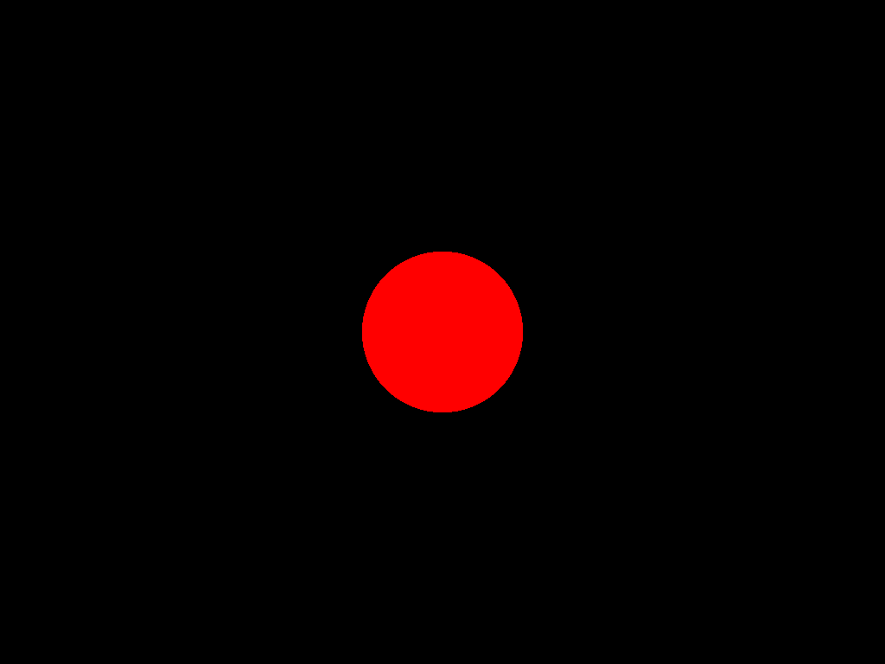

## 2. More balls.

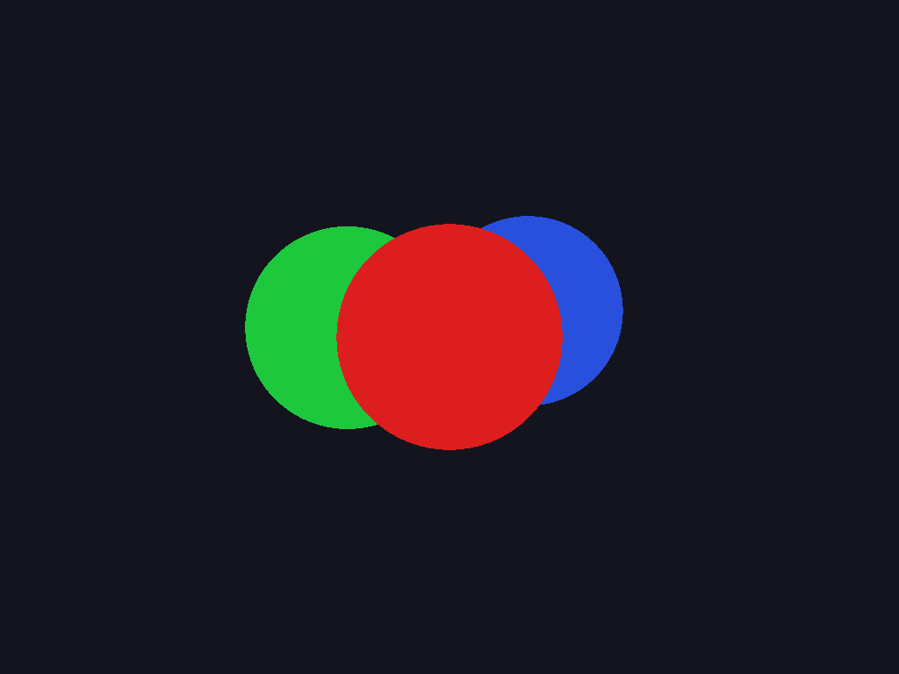

## 3. Add plane. Balls get floor.

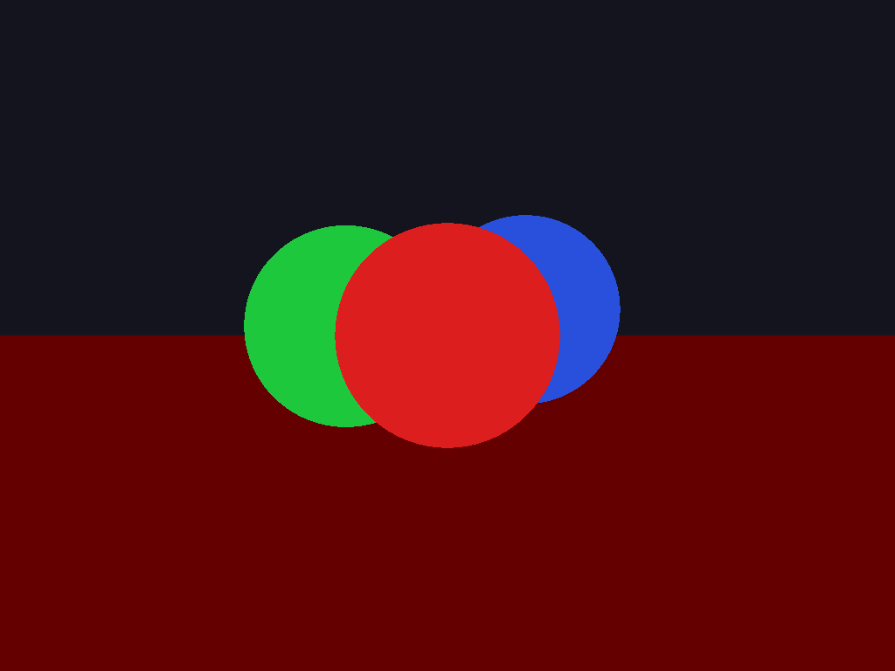

## 4. Add lights.

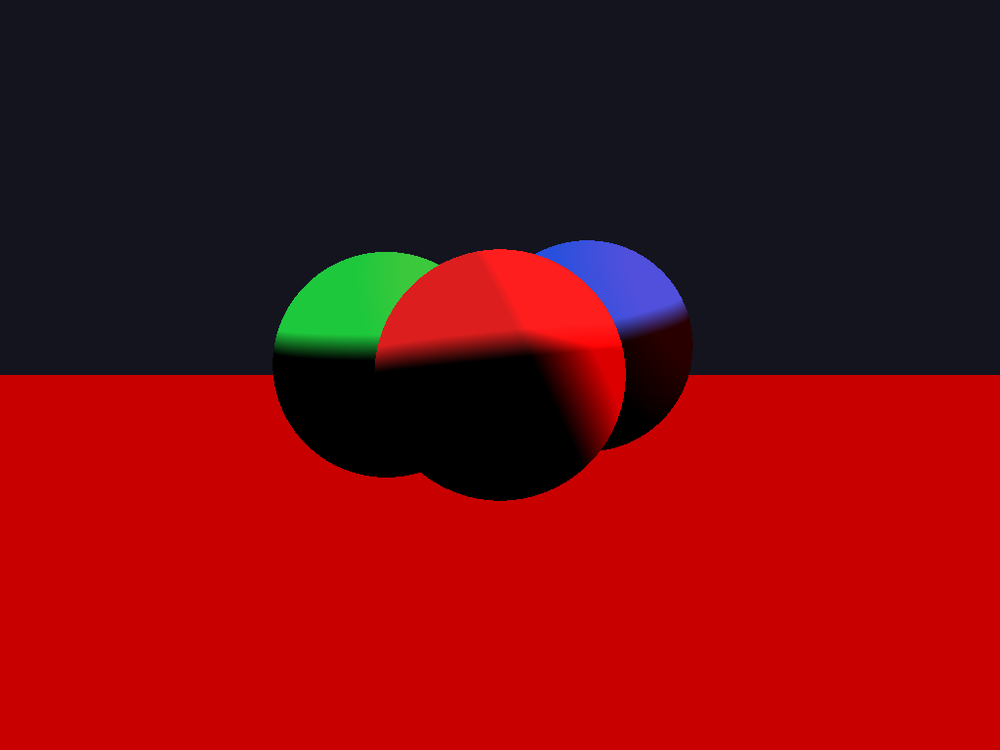

## 5. Add ambient shading.

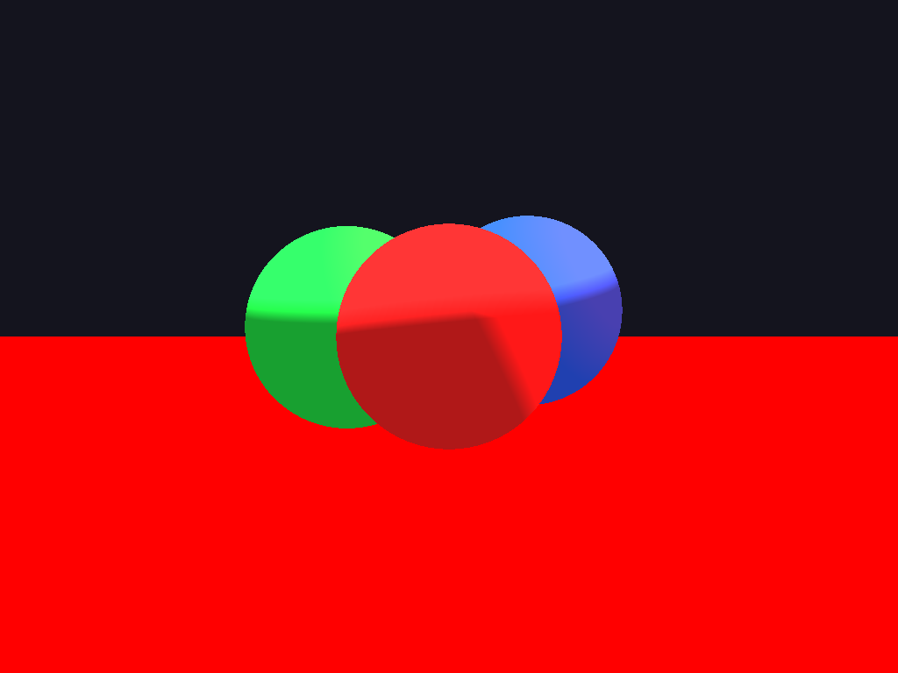

## 6. Make shiny. Blinn–Phong shading.

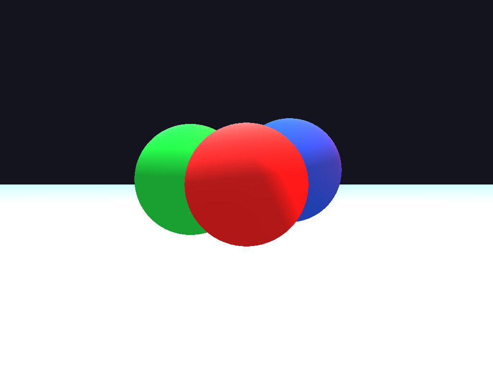

## 7. Add shadows.

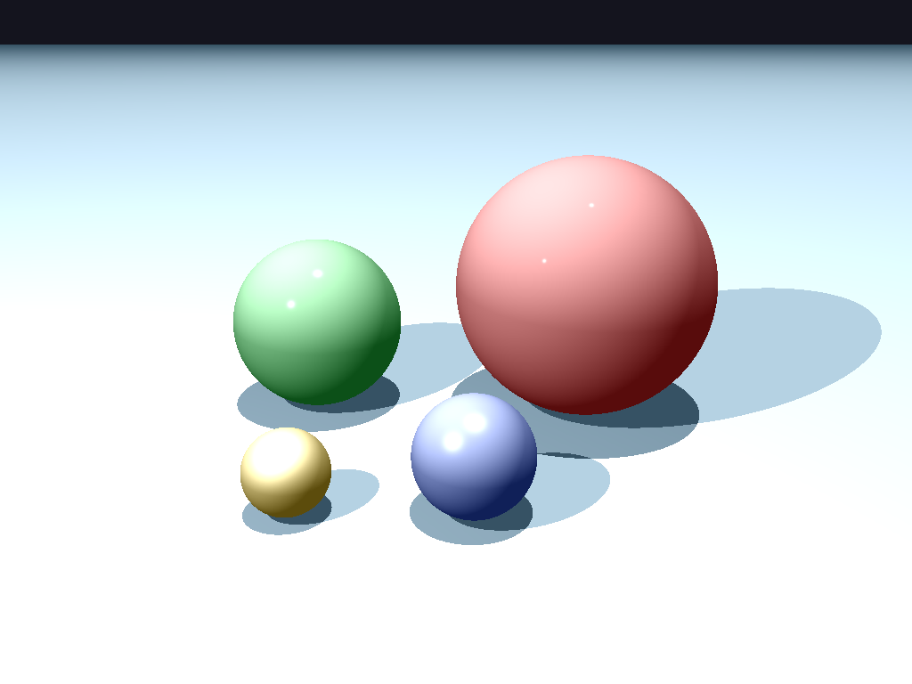

## 8. Yellow light. Purple light.

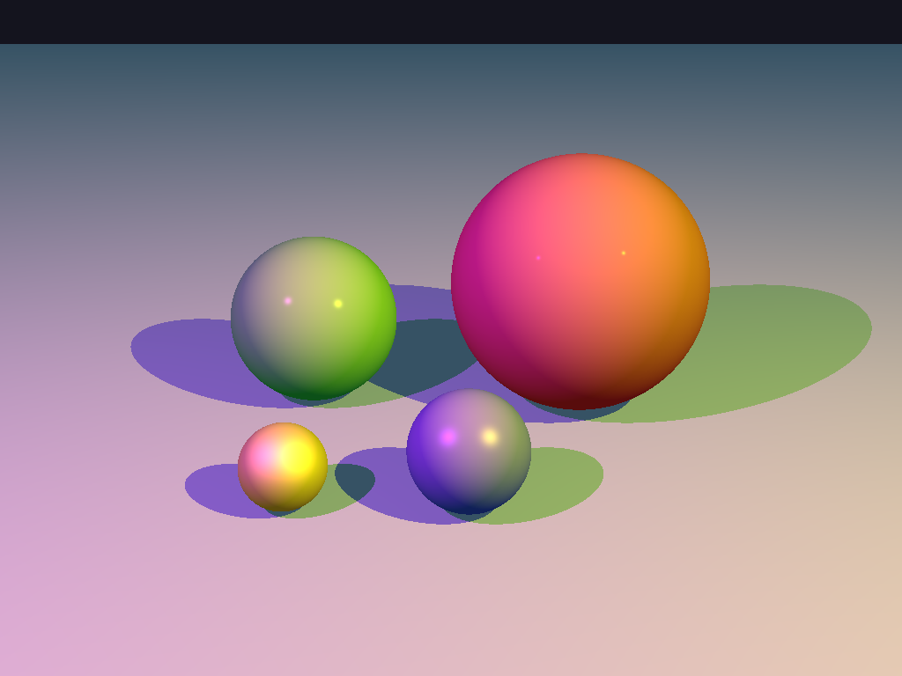

## 9. Reflective balls.

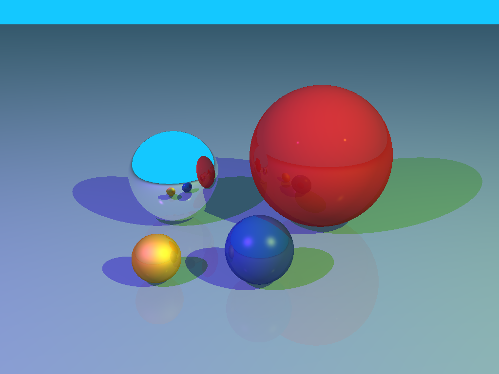

## 10. Refraction and glass-like materials.

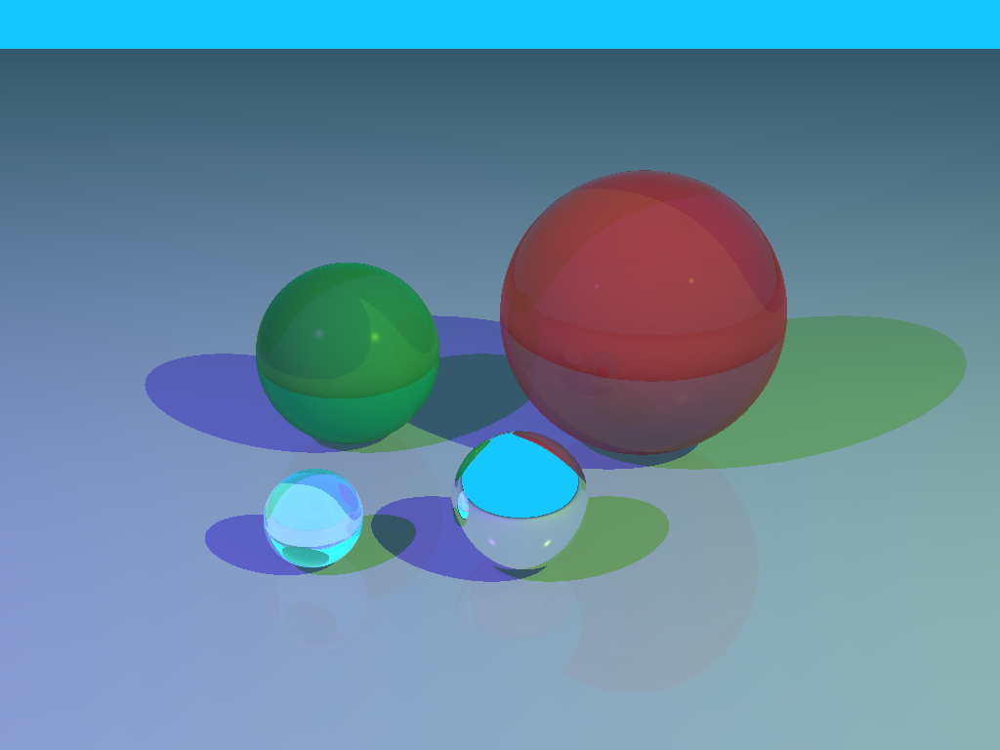

## 11. Indexed PolyMesh

`PolyMesh` stores positions, normals, and indexed triangles. Each triangle has
three position indices and three independent normal indices, so one position
can use a different normal on each adjoining face. This is required for hard
edges and matches OBJ's `v//vn` face-corner representation.

The mesh hit test linearly calls `Triangle::hit` for every triangle and keeps
the closest result. A triangle uses Moller-Trumbore intersection. Its
barycentric coordinates weight the three vertex normals before the resulting
normal is normalized and sent to the lighting code.

Hard normals (one normal shared by all three corners of each face):

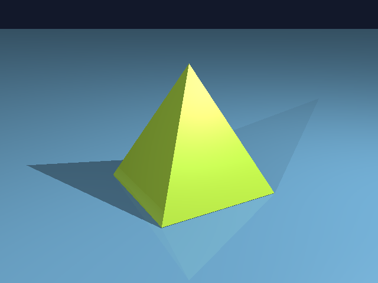

Smooth normals (normals shared by position and interpolated across faces):

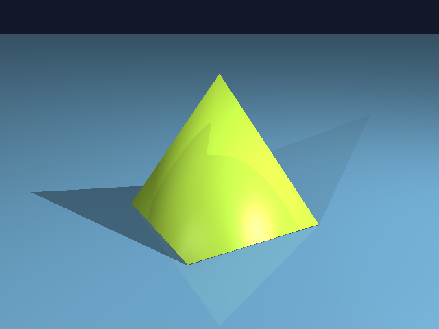

## OBJ reader and supplied models

The simplified reader supports:

- `v x y z` positions
- `vn x y z` normals
- triangle faces written as `f v v v`, `f v//vn ...`, or `f v/vt/vn ...`
- independent position and normal indices
- generated area-weighted smooth normals when an OBJ has no `vn` records

It intentionally rejects quads and n-gons, and it ignores texture coordinates,
materials, groups, and smoothing-group records.

The supplied `objects/capuchino.obj` loads as 33,120 vertices and 50,000
triangles. Because this assignment requires linear triangle search, its preview
is rendered at 192 x 192. The full model is still loaded and intersected:

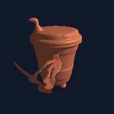

`objects/vase.obj` is also preserved and tested. It contains 8 vertices and 12
triangles and has no normals, so it exercises automatic normal generation.

## How the vase scene was made

The scene contains a 16-sided lathed vase, a table made from five boxes, a
floor/wall studio backdrop, and three lights. The generated scene meshes are in
`objects/vase_scene_*.obj`.

### Blender workflow

1. In a side view, draw the vase's half-profile from base to lip.
2. Use the Screw modifier around the Y axis with 16 steps and 360 degrees.
3. Apply the modifier and choose **Shade Smooth** for the connected vase sides.
4. Build the table from one flattened cube and four narrow cubes. Keep these
   faces flat-shaded.
5. Add two large planes for the floor and back wall.
6. Add a warm key light at `(-3.5, 4.5, -4)`, a cool fill at `(4, 2.5, -2)`,
   and a rim light at `(0, 4, 2)`.
7. Export the vase, table, and backdrop as Wavefront OBJ with **Selection Only**,
   **Triangulate Faces**, **Write Normals**, and **Keep Vertex Order** enabled.

Blender is not installed in the automated development environment, so
[`tools/generate_vase_scene.py`](tools/generate_vase_scene.py) reproducibly
creates the same low-poly lathe, boxes, and backdrop geometry. Running it
regenerates all three scene OBJ files.

### Three camera angles

Front three-quarter view:

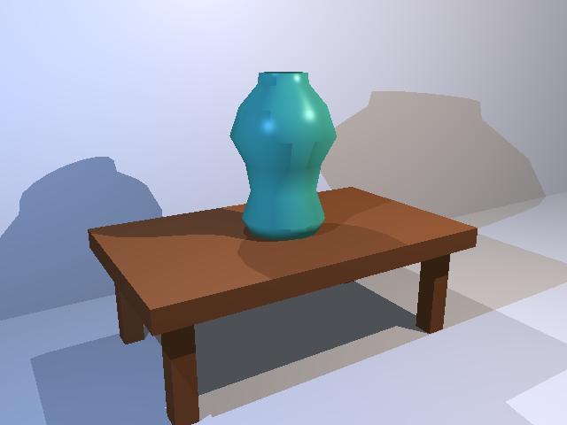

Left view:

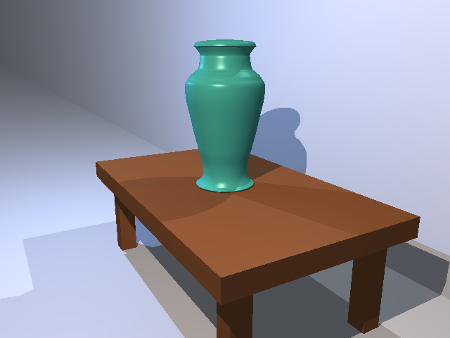

Right view:

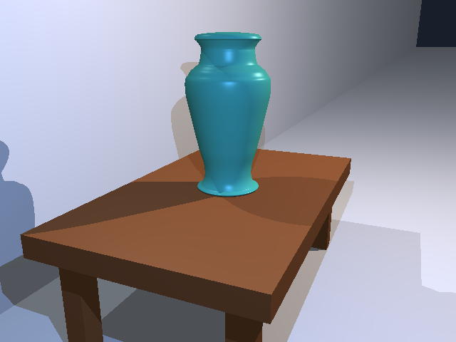

## Run it

```sh
# Default: render all three vase views at 640 x 480
cargo run --release -- vase

# Mesh-normal comparison
cargo run --release -- pyramid
cargo run --release -- pyramid-smooth

# Full 50,000-triangle supplied OBJ at preview resolution
cargo run --release -- capuchino

# Tests and static checks
cargo test
cargo clippy --all-targets -- -D warnings
```

The timed presentation outline is in [DEMO_SCRIPT.md](DEMO_SCRIPT.md).

## To be continued... 😆
