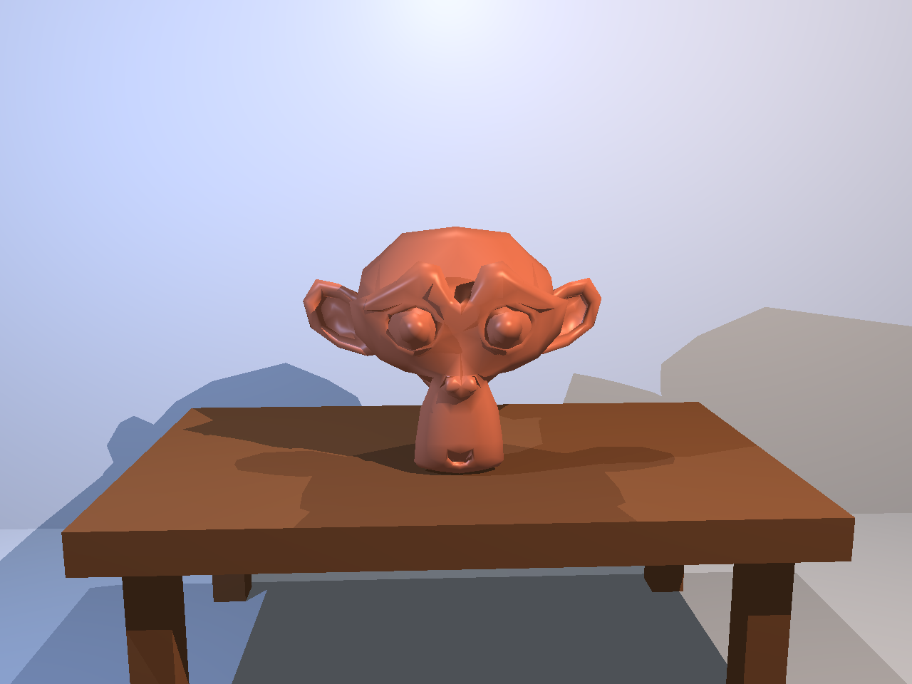

# Rust Ray Tracer

Ray tracing 3D renderer built from scratch with Rust lang. (in progress)

[Rebuild pictures](docs/render-progression.py).

## 1. One ball.


## 2. More balls.


## 3. Add plane. Balls get floor.


## 4. Add lights.


## 5. Add ambient shading.


## 6. Make shiny. Blinn–Phong shading.


## 7. Add shadows.


## 8. Yellow light. Purple light.


## 9. Reflective balls.


## 10. Refraction and glass-like materials.


## 11. Indexed PolyMesh

`PolyMesh` stores positions, normals, and indexed triangles. Each triangle has
three position indices and three independent normal indices, so one position
can use a different normal on each adjoining face. This is required for hard
edges and matches OBJ's `v//vn` face-corner representation.

`PolyMesh` builds a bounding volume hierarchy by recursively splitting triangle
centroids along their widest axis. Rays visit the nearer child box first and
only test the triangles in intersected leaves, with at most eight triangles per
leaf. A triangle uses Moller-Trumbore intersection, and its barycentric
coordinates weight the three vertex normals before the resulting normal is
normalized and sent to the lighting code.

Hard normals (one normal shared by all three corners of each face):


Smooth normals (normals shared by position and interpolated across faces):


## OBJ reader and supplied models

The simplified reader supports:

- `v x y z` positions
- `vn x y z` normals
- triangle faces written as `f v v v`, `f v//vn ...`, or `f v/vt/vn ...`
- independent position and normal indices
- generated area-weighted smooth normals when an OBJ has no `vn` records

It intentionally rejects quads and n-gons, and it ignores texture coordinates,
materials, groups, and smoothing-group records.

The supplied `objects/capuchino.obj` loads as 33,120 vertices and 50,000
triangles. Its compact preview still loads and intersects the full model:


The updated Tinkercad `objects/vase.obj` contains 36,944 vertices and 73,884
triangles. It has no normal records, so the loader generates area-weighted
smooth normals. The scene converts Tinkercad's Z-up coordinates to the
renderer’s Y-up coordinates, centers the vase, and scales it onto the tabletop
without modifying the OBJ file.

The bundled Suzanne model is converted from Blender's Z-up coordinates, placed
on the same table, and rendered with the same three-light studio:



## How the vase scene was made

The scene contains the detailed Tinkercad vase, the committed
`objects/vase_scene_table.obj` mesh, a floor and wall built from planes, and
three lights. The table is loaded directly; no geometry generator runs while
rendering.

### Blender workflow

1. In a side view, draw the vase's half-profile from base to lip.
2. Use the Screw modifier around the Y axis with 16 steps and 360 degrees.
3. Apply the modifier and choose **Shade Smooth** for the connected vase sides.
4. Build the table from one flattened cube and four narrow cubes. Keep these
   faces flat-shaded.
5. Add two large planes for the floor and back wall.
6. Add a warm key light at `(-3.5, 4.5, -4)`, a cool fill at `(4, 2.5, -2)`,
   and a rim light at `(0, 4, 2)`.
7. Export the vase, table, and backdrop as Wavefront OBJ with **Selection Only**,
   **Triangulate Faces**, **Write Normals**, and **Keep Vertex Order** enabled.

Blender is not installed in the automated development environment. The vase
and table are therefore loaded from their committed OBJ files.

### Three camera angles

Front three-quarter view:


Left view:


Right view:


## Run it

```sh
# Default: render all three vase views at 640 x 480
cargo run --release -- vase

# Mesh-normal comparison
cargo run --release -- pyramid
cargo run --release -- pyramid-smooth

# Full 50,000-triangle supplied OBJ at preview resolution
cargo run --release -- capuchino

# Suzanne in the vase studio at 1280 x 960
cargo run --release -- suzanne

# Tests and static checks
cargo test
cargo clippy --all-targets -- -D warnings
```

Each completed image prints its render time as hours, minutes, and seconds,
for example `render time: 00h 00m 59.477s`.

The timed presentation outline is in [DEMO_SCRIPT.md](DEMO_SCRIPT.md).

## To be continued... 😆
